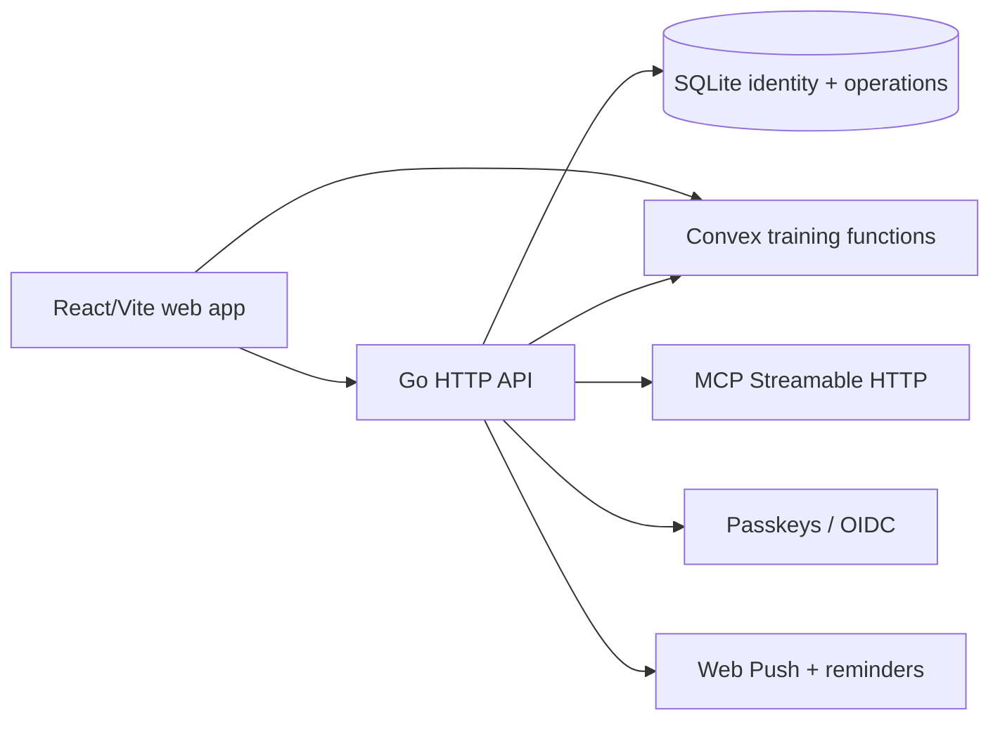

<p align="center">
  
</p>

# Set & Signal 🏋️ · Make the next set obvious

[](https://github.com/aranlucas/set-and-signal-unified/actions/workflows/ci.yml)
[](https://github.com/aranlucas/set-and-signal-unified/actions/workflows/consolidated-apps.yml)
[](LICENSE)

Set & Signal is a self-hostable workout planner and training log for planning
sessions, recording sets, reviewing history, and asking an AI assistant about
training data. The product ships as a React/Vite web app embedded in a Go
server, with passkeys/OIDC sign-in, Convex-backed training records, SQLite for
identity and operational state, and an MCP endpoint for assistant clients.

> **A session in the real world:** plan a push day, log the working sets as you
> go, then ask the assistant what to train next. Your history, prescription,
> and account boundary stay in the same self-hosted system.

The project is designed for a single deployment you control. It includes an
exercise catalogue, progression and prescription helpers, workout history,
bodyweight tracking, reminders, push notifications, localization, and a
read/write MCP surface protected by the same account boundary as the web app.

## Android-first consolidation

The unified repository places the native Android app in [`apps/android`](apps/android)
and Garmin Health, Activity, FIT, and Training into [`apps/garmin`](apps/garmin).
They share the root pnpm workspace and lockfile with the existing web application.

The product now supports web planning, native Android strength sessions, and
built-in Garmin connection, workout preview/scheduling, FIT-result review, and
phone/watch reconciliation. Android saves completed workouts and sync operations
atomically in SQLite. Shared training packages preserve Fivefold progression,
original units and source identities across Android, web and the Go/MCP adapter.
Account history and progress include phone, web and imported watch records.

The [unified repository](https://github.com/aranlucas/set-and-signal-unified) combines
all three audited source histories and the integrated implementation on `main`.
Deployment and real-account/watch validation remain; no workout was sent to a live Garmin account. See the
[implementation and rollout guide](docs/consolidation/implementation.md),
[verification evidence](docs/consolidation/verification.md),
[product architecture](docs/consolidation/product.md), and
[source provenance](docs/consolidation/imports.json).

From the repository root:

```sh
pnpm install --frozen-lockfile
pnpm dev:android
pnpm dev:garmin
pnpm check:shared
pnpm check:android
pnpm check:garmin
pnpm build:android
pnpm build:garmin
```

`dev:android` starts Metro; device installation still uses the Android app's documented
Expo workflow. `build:android` exports the Android JavaScript/Hermes bundle, rather than
building a signed APK. Web/API development continues with `pnpm dev` below. The two
additional dev servers are opt-in, so web/API startup needs no Garmin credentials.
The imported apps retain their runtime and deployment identifiers during migration.

## Run locally

Requires Go 1.27+, Node.js 24+, pnpm 12+, a Convex
deployment, and an OAuth or passkey configuration. The API refuses to start
without `CONVEX_URL`; the full training setup and storage rules are in
[docs/convex.md](docs/convex.md).

Start the API and web app together, then open `https://set-and-signal.localhost`:

```bash
pnpm install --frozen-lockfile
pnpm dev
```

`pnpm dev` runs `dev:api` and `dev:web` in parallel. The API reads `CONVEX_URL` from
`web/.env.local` and stores data in `./data`.

Both run through [Portless](https://github.com/vercel-labs/portless) (a dev
dependency): the API at `https://api.set-and-signal.localhost`, the web app at
`https://set-and-signal.localhost`. The first run may ask for `sudo` to bind port 443
and trust a local certificate. Vite proxies `/api`, `/oauth`, `/.well-known`, and
`/mcp` to the API, so OAuth callbacks, session cookies, and the local MCP endpoint
all use the web origin. Passkeys registered for `localhost` do not carry over to the
new hostname.

For a fresh development deployment, run `pnpm exec convex dev` from `web` and
follow the setup guide to configure `AUTH_ISSUER` and `AUTH_JWKS`. Keep the
generated `web/.env.local`, signing keys, and any provider credentials out of
Git.

## Verify

```bash
go test -race ./...
go vet ./...
(cd .railway && go test ./... && go vet ./...)
```

The service is licensed under the [GNU AGPL v3 or later](LICENSE). See [`SECURITY.md`](SECURITY.md) for vulnerability reports.

## Architecture



The Go composition root is `cmd/opengym-api`. HTTP and MCP protocol concerns
live in `internal/httpapi`; training state, analytics, scheduling, and
progression live in `internal/training`; SQLite access and migrations live in
`internal/store`. The frontend follows the `app → features → domain → shared`
direction described in [docs/architecture.md](docs/architecture.md). Edit
exercise content in `web/catalog`; generated instruction files are rebuilt by
the web scripts.

## Configuration essentials

`.env.example` documents the complete runtime surface. The settings most
people need are:

| Variable                                  | Why it matters                                                                |
| ----------------------------------------- | ----------------------------------------------------------------------------- |
| `CONVEX_URL`                              | Required hosted training deployment.                                          |
| `DATA_DIR` / `DB_PATH`                    | Persistent SQLite, session, push, and signing-key storage.                    |
| `PUBLIC_URL` / `ORIGIN`                   | Browser origin and OAuth/MCP issuer; use a reachable HTTPS URL in production. |
| `RP_ID` / `RP_NAME`                       | WebAuthn relying-party identity.                                              |
| `GOOGLE_*`, `GITHUB_*`, `APPLE_*`         | Optional OIDC providers for sign-in and MCP OAuth.                            |
| `OPENROUTER_API_KEY` / `OPENROUTER_MODEL` | Optional AI workout planning.                                                 |

## Further documentation

- [Architecture](docs/architecture.md) — dependency direction and build layout.
- [Convex setup and storage](docs/convex.md) — hosted training ownership,
  offline queues, keys, and current format requirements.
- [Data model](docs/data-model.md) — storage ownership and current contracts.
- [Product](docs/product.md) and [design](docs/design.md) — user flows and UI
  constraints.
- [Railway deployment](.railway/README.md) — infrastructure configuration.

## Status and privacy

The repository is an active, self-hosted application with hosted
Convex training storage. Training records are account-scoped, but a deployment's
operator controls the API, Convex project, and persistent volume. Review
`SECURITY.md` and configure access controls before exposing an instance to
other users.

### Shared lint policy

The web client uses the Oxforge presets while keeping its established PascalCase React component filenames and camelCase helpers. Inline object and tuple types are named at module scope; intentionally backgrounded promises attach rejection handlers. Formatting commands explicitly load oxfmt.config.ts, including the generated-file exclusions.
